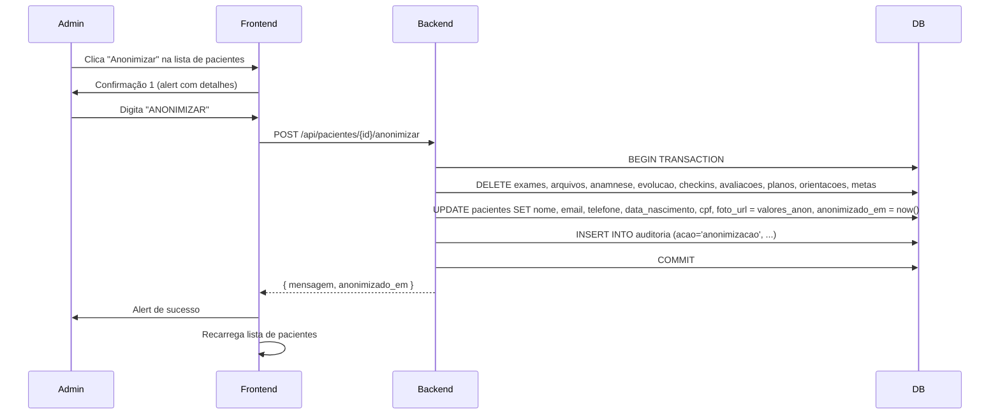

# Política de Retenção de Dados - LGPD

> **RASCUNHO — REVISAR com advogado e conselho profissional (CRN/CFM)** antes de colocar em produção.

Este documento define os prazos de retenção por tipo de dado no sistema AC Hub / ACNUTRI, conforme os princípios da LGPD (Lei nº 13.709/2018): **finalidade, necessidade, adequação** e **limitação do armazenamento**.

---

## Tabela de Prazos de Retenção

| Tipo de Dado / Tabela | Base Legal / Finalidade | Prazo de Retenção | Ação ao Término | Observações |
|---|---|---|---|---|
| **Dados cadastrais do paciente** (`pacientes`) | Execução de contrato, obrigação legal (CFM/CRN) | **20 anos** após último atendimento ou enquanto durar a relação contratual | Anonimização (`anonimizarPaciente`) | CPF, nome, e-mail, telefone, nascimento → valores anônimos; `anonimizado_em` preenchido |
| **Anamnese** (`anamneses`) | Execução de contrato, legítimo interesse (histórico clínico) | **20 anos** após último atendimento | Exclusão automática na anonimização do paciente | Apagada junto com anonimização |
| **Exames e arquivos** (`exames`, `arquivos_paciente`) | Execução de contrato, obrigação legal | **20 anos** após último atendimento | Exclusão automática na anonimização | PDFs, imagens, laudos |
| **Evolução / Check-ins** (`evolucao`, `checkins_semanais`) | Execução de contrato, legítimo interesse | **20 anos** após último atendimento | Exclusão automática na anonimização | Peso, medidas, fotos |
| **Avaliações físicas** (`avaliacoes_fisicas`) | Execução de contrato | **20 anos** após último atendimento | Exclusão automática na anonimização | TMB, GET, composição corporal |
| **Planos alimentares e versões** (`planos_alimentares`, `planos_versoes`, `orientacoes_nutricionais`) | Execução de contrato | **20 anos** após último atendimento | Exclusão automática na anonimização | Inclui snapshots de versões |
| **Metas do paciente** (`metas_paciente`) | Execução de contrato | **20 anos** após último atendimento | Exclusão automática na anonimização | |
| **Consentimentos LGPD** (`consentimentos`) | Obrigação legal (Art. 7º, §5º LGPD) | **5 anos** após revogação ou término da finalidade | Arquivamento (não exclusão) | Manter registro de *quando* e *como* consentiu |
| **Solicitações LGPD** (`solicitacoes_lgpd`) | Obrigação legal (Art. 18 LGPD) | **5 anos** após resolução | Arquivamento | Registro de prazos, respostas, decisões |
| **Auditoria** (`auditoria`) | Segurança, legítimo interesse, obrigação legal | **2 anos** (mínimo) / **5 anos** recomendado | Arquivamento / Exclusão | Logs de acesso, criação, atualização, exclusão, exportação |
| **Convites de paciente** (`convites`) | Execução de contrato | **1 ano** após expiração/uso | Exclusão | Token de curta duração (7 dias) |
| **Usuários da equipe** (`usuarios`) | Execução de contrato, obrigação trabalhista | **Conforme legislação trabalhista** (mín. 5 anos pós-desligamento) | Anonimização parcial | Manter logs de auditoria vinculados |
| **Empresas / Multi-tenant** (`empresas`, `empresa_modulos`) | Execução de contrato | Enquanto contrato ativo + 5 anos | Arquivamento | Dados de billing (Asaas) seguem política do provedor |

---

## Regras Gerais

1. **Nenhuma exclusão automática** sem intervenção humana (admin/super_admin) — a anonimização é **sempre sob demanda** via `POST /api/pacientes/{id}/anonimizar`.
2. **Anonimização ≠ Exclusão**: o registro do paciente permanece (para integridade referencial de auditoria), mas todos os dados pessoais (PII) e dados clínicos vinculados são removidos/substituídos.
3. **Auditoria imutável**: a tabela `auditoria` nunca é alterada; apenas novos registros são inseridos.
4. **Backup**: backups diários/semanais seguem a mesma regra — dados anonimizados no banco principal também o são nos backups subsequentes.
5. **Solicitação do titular**: se o paciente pedir exclusão (Art. 18, VI LGPD), abre-se `solicitacoes_lgpd` tipo `exclusao` → análise jurídica → se deferida, executa anonimização.
6. **Dados de crianças/adolescentes**: se houver, aplicar prazo até maioridade + 20 anos (Art. 14 LGPD).

---

## Fluxo de Anonimização (Resumo Técnico)

---

## Checklist de Revisão (para advogado/conselho)

- [ ] Prazo de 20 anos para dados clínicos está alinhado com Resolução CFM nº 2.217/2018 / CRN?
- [ ] Prazo de 5 anos para consentimentos e solicitações LGPD atende Art. 16 LGPD?
- [ ] Auditoria de 2-5 anos atende normas de segurança da informação (ISO 27001, LGPD Art. 48)?
- [ ] Anonimização irreversível atende definição de "dado anonimizado" (LGPD Art. 5º, III)?
- [ ] Necessidade de termo de guarda para prontuário físico (se houver)?
- [ ] Procedimento para solicitação de portabilidade (Art. 18, V LGPD) já implementado (`GET /api/paciente/meus-dados`)?
- [ ] Dados de billing (Asaas) — política de retenção do provedor revisada?

---

## Referências

- LGPD — Lei nº 13.709/2018 (Arts. 5º, 7º, 16, 18, 48)
- Resolução CFM nº 2.217/2018 (Prontuário Médico)
- Código de Ética do Nutricionista (CRN)
- ISO 27001:2022 — A.8.10, A.8.11 (Retenção e Exclusão de Informação)